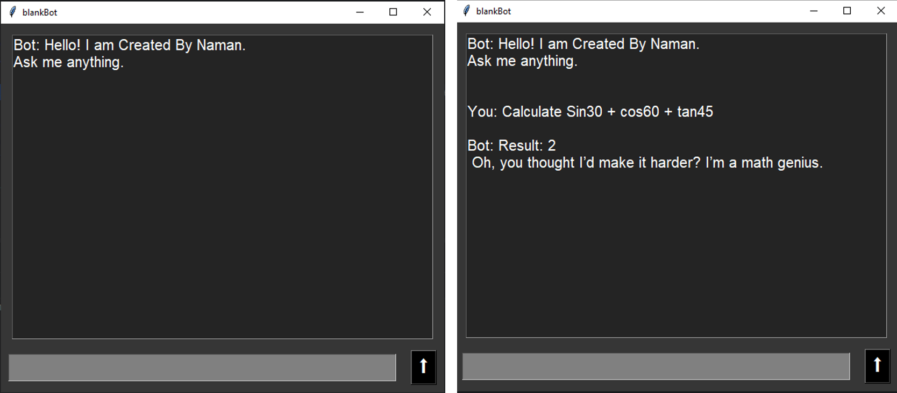

# 
A simple Desktop ChatBot made using Tkinter and Groq API

Designed to provide quick, non-serious, and sometimes rocking responses through a lightweight desktop GUI.

---

---
## Features

- AI-powered chatbot (openai/gpt-oss-20b)
- Powered by Groq
- Simple Tkinter GUI
- Supports follow-up questions/answers
- Press `Enter` to send messages or use the button provided in UI.
- Prevents multiple requests while generating a response
- Uses threading
- Response animation
- You can customize AI personality.

> You are free to use, modify, copy, distribute, and sell this project or modified versions of it.
---

---
## Tools Used

- Python
- Tkinter
- Groq API
- OpenAI Python Module
- Python Threading

---

## Setup
To run this program perform the following steps:
- Get Your Groq API key from https://console.groq.com/keys
- Replace "ENTER YOUR API KEY HERE" with your actual API key.
- Install OpenAI module using `pip install openai` .
> Requires python 3.9+
---
### ⚠️ AI Disclaimer
blankBot generates responses using an AI model. AI-generated content may sometimes be inaccurate, inappropriate, offensive, or misleading. The creator of this project does not endorse or intentionally generate such content and is not responsible for content generated by the AI in response to user input. Users are responsible for how they use the generated content.
---

  

